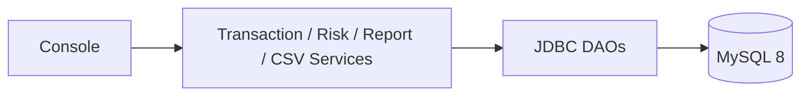

# FinGuard CLI

A Java 17 console banking transaction risk analyzer. Demonstration rules flag records for human review; they do not establish fraud and are not a production fraud system.

## Features

Menu-driven JDBC application, MySQL persistence, unique references, audit trail, explainable scores, CSV import/export (quoted-field support), summaries and status counts. Amounts use `BigDecimal`; SQL uses prepared statements.

## Requirements and setup

Install Java 17+, Maven 3.9+, and MySQL 8. Create schema with `mysql -u root -p < schema.sql`, then set `DB_URL=jdbc:mysql://localhost:3306/finguard`, `DB_USER`, and `DB_PASSWORD` in the terminal environment. Optional rule settings: `FG_HIGH_VALUE` (5000), `FG_DAILY_LIMIT` (10000), `FG_RAPID_COUNT` (3), `FG_WINDOW_MINUTES` (10), `FG_MEDIUM_SCORE` (30), `FG_HIGH_SCORE` (60). Never commit credentials.

```powershell
$env:DB_URL='jdbc:mysql://localhost:3306/finguard'; $env:DB_USER='finguard'; $env:DB_PASSWORD='your-password'
mvn -s .mvn/settings.xml test
mvn -s .mvn/settings.xml org.codehaus.mojo:exec-maven-plugin:3.5.0:java
```

When `DB_URL` is absent, startup explains setup and exits; it does not claim to save data. There is no memory mode.

## Risk rules

High-value (+30), rapid account activity (+25), repeated amount (+20), daily total above threshold (+35), and unusually large/frequent demo activity (+15); cap 100. Risk level thresholds default to LOW <30, MEDIUM 30?59, HIGH >=60. Only one score is added per rule evaluation. Rules are illustrative heuristics; flagged transactions need review.

## CSV

Required headers: `account_id,reference,amount,currency,type,merchant,timestamp`; optional `status`. Timestamp format: ISO local date-time (`yyyy-MM-ddTHH:mm:ss`). See `sample-data/`. Import prints successful/rejected row counts and row errors; a unique reference collision is rejected by the database.

## Project structure

`app` menu, `dao` JDBC access, `service` business/risk/report/CSV logic, `model` domain types, `util` validation/connection, `config` thresholds. `schema.sql` defines transactions, audit logs, and risk alerts.



## Example

Add a debit of `7999 INR` above the default threshold and the record receives a high-value explanation. Several rapid payments on one account may receive additional review reasons. Option 6 lists flagged records; option 12 lists HIGH risk records.

## Testing and limitations

`mvn test` runs unit tests without MySQL. Database integration requires a configured MySQL 8 instance and is not exercised by those unit tests. Future work: integration tests with disposable database, configurable timezone/currency policy, pagination, and richer audit queries.
